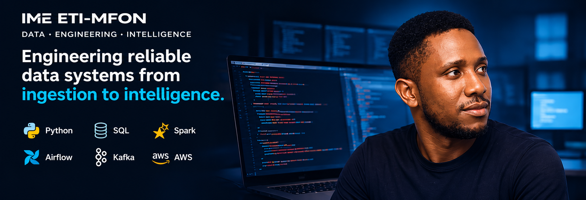

## Hi there, I'm Ime Eti-mfon 👋

I build data systems that solve real business problems.

My tech journey began with data science, but over the years my focus has expanded beyond building machine learning models. Today, I work across the full data lifecycle -designing data pipelines, developing analytics solutions, building machine learning applications, and creating scalable architectures that turn data into business value.

I'm particularly interested in the intersection of **Data Engineering, Machine Learning, MLOps, Enterprise Data Architecture, and AI.** My goal is simple: build intelligent systems that organizations can trust, scale, and rely on.

Alongside my professional work, I'm building **Zilstack** - a data solutions company focused on helping organizations unlock the full value of their data through Analytics, Business Intelligence, Machine Learning, and Data Engineering.

I enjoy solving difficult problems, writing about technology, contributing to open-source projects, and continuously learning.

## What You'll Find Here

This GitHub is where I document my learning journey and share projects across:

- Data Engineering
- Data Science
- Machine Learning
- MLOps
- Business Intelligence
- Enterprise Data Architecture
- Cloud Data Platforms
- Data Visualization
- AI Applications

Expect practical projects, reusable code, technical articles, and experiments focused on solving real-world business problems.

## Technical Stack

- **Languages:** Python, SQL
- **Data Engineering:** Apache Airflow, ETL & ELT Pipelines, Data Warehousing, Data Modeling, PostgreSQL, MySQL
- **Data Science & Machine Learning:** Pandas, NumPy, Scikit-learn, TensorFlow, Statistical Analysis, Predictive Modeling
- **Analytics & BI:** Power BI, Excel, Dashboard Development, KPI Design, Business Analytics
- **Cloud:** AWS, Microsoft Azure

## Current Focus

At the moment I'm focused on:

- Building production-ready data pipelines
- Designing scalable data architectures
- Learning advanced MLOps practices
- Developing cloud-native data platforms
- Publishing technical articles and open-source projects
- Growing Zilstack into a full-stack data solutions company

## Long-Term Vision

My long-term ambition is to become a Data Architect, designing enterprise-scale data platforms that enable organizations to make better decisions, deploy AI responsibly, and build intelligent products.

I also want to contribute to the global data community through open-source software, technical writing, research, and mentoring.

## Let's Connect

I enjoy connecting with people working in Data Engineering, AI, Analytics, and Enterprise Architecture.

Whether it's discussing ideas, collaborating on projects, or sharing knowledge, I'd love to connect.

**LinkedIn:**
https://www.linkedin.com/in/imeetimfon/

